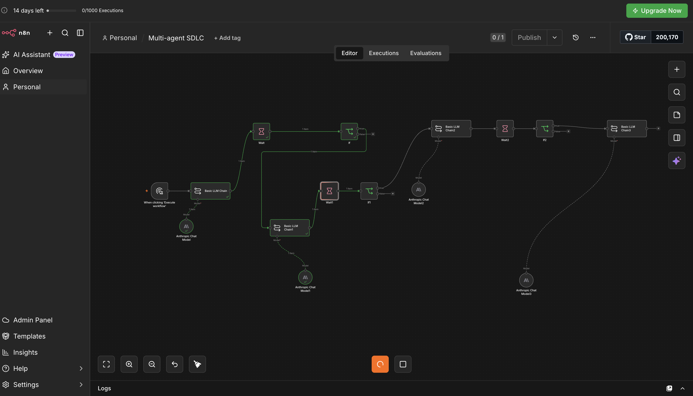
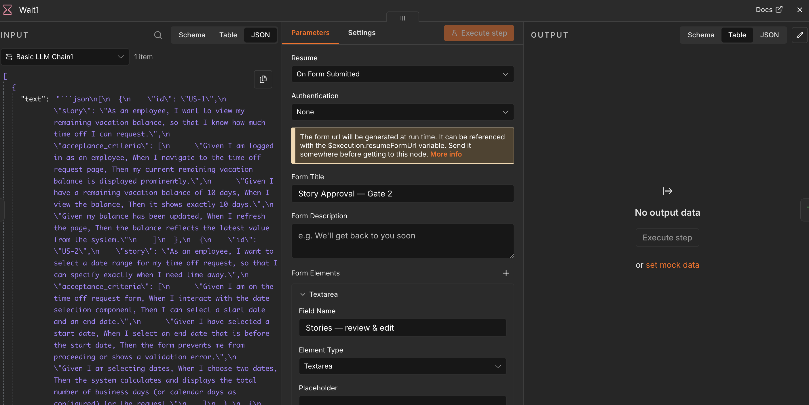
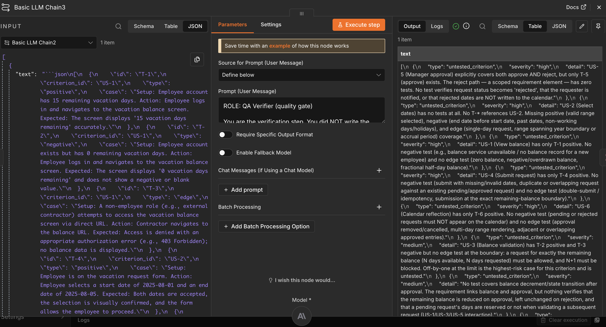

# Agentic SDLC Delivery Assistant

[](https://github.com/kumarohitgupta/agentic-sdlc-assistant/actions/workflows/ci.yml)

A multi-agent system that turns a raw feature request into a review-ready delivery package: refined requirements, user stories with acceptance criteria, test cases, and an automated QA gap report. A human approval gate sits at every phase.

It runs two ways, from the same prompts:

- **Python, in a terminal.** One install, one command, with interactive approval gates. There is an offline demo that needs no API key.
- **n8n, no code.** Import [`n8n/workflow.json`](n8n/workflow.json), add a Claude credential, and get a shareable form where each gate is a review page in the browser.

> **What this is:** a working prototype and reference design for applying multi-agent orchestration to the software delivery lifecycle (SDLC). It shows how to structure task-optimized agents, route work across cheaper and stronger models to control cost, and keep a human in the loop where judgment matters.
>
> **What this is not:** a production developer tool or a replacement for a delivery team.

---

## Quickstart (Python, 2 minutes)

Requires Python 3.10+.

```bash
git clone https://github.com/kumarohitgupta/agentic-sdlc-assistant
cd agentic-sdlc-assistant
pip install -e .

# 1. See it work with no API key (canned outputs, no cost)
sdlc-assistant demo

# 2. Run it for real
cp .env.example .env          # then paste your key from https://platform.claude.com
sdlc-assistant run --feature-file examples/sample-input-feature.md
```

At each gate the pipeline pauses and shows you the artifact:

```
[a]pprove  [r]evise with feedback  [e]dit JSON  [x] reject and stop
```

**Revise** sends your notes back to the agent for a redraft. This is also where you answer the open questions the Analyst raised. **Edit** opens the JSON in your editor. **Reject** stops the run; nothing downstream executes. The finished spec is saved to `runs/<timestamp>-<slug>/delivery-spec.md` and `.json`, with a run log of tokens and cost per agent.

Other useful commands:

```bash
sdlc-assistant run --feature "Users can export their data as CSV"   # inline request
sdlc-assistant run --auto-approve --feature-file my-feature.md      # unattended (demos / CI)
sdlc-assistant eval                                                 # the evaluation set, tabulated
sdlc-assistant run --model-qa-verifier claude-sonnet-5-5 ...        # re-route any agent
```

## Quickstart (n8n, no code)

1. In n8n (cloud or self-hosted), go to **Workflows → Import from file** and choose [`n8n/workflow.json`](n8n/workflow.json).
2. Open any **Claude** model node, create an **Anthropic** credential with your API key, and select it on all four model nodes.
3. Click **Test workflow**. A form opens; describe the feature and submit.
4. Each gate appears as the next page of the same form: review the artifact, then choose **Approve**, **Revise** (with feedback), or **Reject**.
5. The last page shows the full Delivery Spec. Activate the workflow to get a production form URL you can share.

Details and troubleshooting: [`n8n/README.md`](n8n/README.md).

## My role & key decisions

I designed and built this system end to end. The decisions I'd point to in a review:

- **Four single-responsibility agents instead of one prompt**, for output quality, cost control, and independent verification. A do-everything prompt is cheaper to wire but worse on all three.
- **Task-optimized model routing.** Each step runs on the cheapest model tier that meets its bar, and the premium model is reserved for the one step where judgment matters most (QA verification). Every run logs its cost next to what the same tokens would cost on the premium model throughout.
- **Human approval gates at the three highest-leverage points**: after requirements, after stories, and at final sign-off. No AI output advances unverified, and a wrong call is caught where it's cheap to unwind.
- **Typed state hand-offs, not chat.** Agents pass a structured Delivery Spec that is schema-checked at every step, which prevents context drift across the chain.
- **A bounded, gap-aware feedback loop.** Scope gaps go back to the Story Writer (and back through Gate 2); thin tests go back to the Test Designer. Capped at two loops.

The design draws on my work on AI strategy for software delivery, where the largest quality gaps sat in **planning and verification** rather than in code generation. That is the gap this system targets.

## The problem

AI coding assistants are fast at *writing* code, but much of the cost and risk in software delivery sits **upstream**, in turning a vague request into well-formed requirements, stories, and tests, and **downstream**, in verifying that what was built covers what was asked.

This project treats the front half of the SDLC as an orchestration problem: a small team of specialized agents, each doing one job well, with a verification agent whose only purpose is to catch gaps before a human signs off.

## What it produces

Given a one-paragraph feature request, the pipeline outputs a **Delivery Spec** containing:

1. A cleaned, disambiguated **requirement**, with open questions flagged
2. **User stories** with Gherkin acceptance criteria, each criterion with its own id (`US-1.AC1`)
3. **Test cases** (positive, negative, and edge) mapped to each criterion id
4. A **QA gap report**, plus a mechanical coverage check showing which criteria lack a test type

See a complete example: [`examples/sample-output-delivery-spec.md`](examples/sample-output-delivery-spec.md). In that run the QA Verifier catches a missing manager-rejection story, the loop sends it back, and the second pass closes it.

## Architecture

```
Feature request
      │
      ▼
[1] Requirements Analyst  (Sonnet) ──► Gate 1: approve / revise / reject
      │
      ▼
[2] Story Writer          (Haiku)  ──► Gate 2: approve / revise / reject ◄──┐
      │                                                                     │ scope gaps
      ▼                                                                     │
[3] Test Designer         (Sonnet) ◄────────────────────────────────┐       │
      │                                                  thin tests │       │
      ▼                                                             │       │
[4] QA Verifier           (Opus)  ── high-severity gaps? (max 2) ───┴───────┘
      │ no
      ▼
  Gate 3: final sign-off ──► Delivery Spec
```


Full reasoning is in **[docs/design-doc.md](docs/design-doc.md)**; the as-built details are in **[docs/implementation.md](docs/implementation.md)**.

## Screenshots

| | |
| --- | --- |
|  | The four-agent pipeline in n8n with its approval gates |
|  | A human-in-the-loop approval form pausing the pipeline mid-run |
|  | The QA Verifier catching coverage gaps the earlier agents left |

## Repository map

| Path | What's inside |
| --- | --- |
| [`sdlc_assistant/`](sdlc_assistant/) | The Python runner: orchestrator, agents, gates, CLI, demo fixtures |
| [`n8n/`](n8n/) | Importable n8n workflow, and the script that builds it from `prompts/` |
| [`prompts/`](prompts/) | The system prompt for each of the four agents (single source for both runtimes) |
| [`docs/design-doc.md`](docs/design-doc.md) | The core design: architecture, agent design, model routing, HITL rationale, failure modes |
| [`docs/implementation.md`](docs/implementation.md) | How it's built in Python and n8n, and what a run produces |
| [`docs/business-case.md`](docs/business-case.md) | Why this matters commercially: cost, speed, and quality framing |
| [`docs/evaluation.md`](docs/evaluation.md) | Evaluation method, rubric, and results table |
| [`docs/build-guide.md`](docs/build-guide.md) | Building the n8n flow by hand, step by step |
| [`examples/`](examples/) | A sample feature request and the Delivery Spec it produces |
| [`evals/`](evals/) | The evaluation cases, including two with planted gaps |
| [`tests/`](tests/) | Tests for the pipeline, gates, loop, parsing and CLI (run offline) |

## Design principles

- **One job per agent.** Narrow agents are easier to prompt, cheaper to run, and easier to debug.
- **Route by task difficulty.** Structuring goes to a cheap model; verification goes to a strong one.
- **Verify before a human sees it.** A dedicated QA agent catches gaps so the human reviews a *checked* draft.
- **Human-in-the-loop where judgment lives.** Approval gates sit where a wrong call is expensive to unwind.
- **Pass structured state, not chat.** Typed, validated hand-offs prevent context drift across the chain.

## Development

```bash
pip install -e ".[dev]"
pytest                               # offline; no API key needed
python n8n/build_workflow.py         # regenerate n8n/workflow.json after editing prompts/
```

## License

MIT — see [LICENSE](LICENSE).
