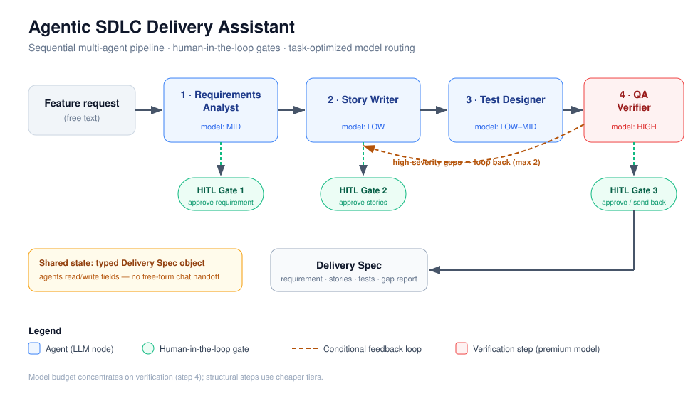

# Agentic SDLC Delivery Assistant

A multi-agent system that turns a raw feature request into a review-ready delivery package — refined requirements, user stories with acceptance criteria, test cases, and an automated QA gap report — with a human approval gate at every phase.

> **What this is:** a reference design + working no-code prototype for applying multi-agent orchestration to the software delivery lifecycle (SDLC). It demonstrates *how* to structure task-optimized agents, route work across cheaper and stronger models to control cost, and keep a human in the loop where judgment matters.
>
> **What this is not:** a production developer tool or a replacement for a delivery team. It is a portfolio-grade prototype and design study.

---

## The problem

AI coding assistants are fast at *writing* code, but most of the cost and risk in software delivery sits **upstream** — in turning a vague request into well-formed requirements, stories, and tests — and **downstream**, in verifying that what was built actually covers what was asked. In competitive benchmarking of AI-native delivery platforms, the largest quality gaps consistently appear in **planning and verification**, not in raw code generation.

This project targets exactly those two gaps. It treats the front half of the SDLC as an orchestration problem: a small team of specialized agents, each doing one job well, with a verification agent whose only purpose is to catch gaps before a human signs off.

## What it produces

Given a one-paragraph feature request, the pipeline outputs a single structured **Delivery Spec** containing:

1. A cleaned, disambiguated **requirement** (with open questions flagged)
2. **User stories** with Gherkin-style acceptance criteria
3. **Test cases** — positive, negative, and edge — mapped to each acceptance criterion
4. A **QA gap report** — where stories don't cover the requirement, or tests don't cover the stories

A human reviews and approves at three checkpoints, so nothing advances on unverified AI output.

## Architecture at a glance

```
Feature request
      │
      ▼
[1] Requirements Analyst ──► HITL Gate 1 (approve requirement)
      │
      ▼
[2] Story Writer ──────────► HITL Gate 2 (approve stories)
      │
      ▼
[3] Test Designer
      │
      ▼
[4] QA Verifier ───────────► HITL Gate 3 (approve / send back)
      │
      ▼
  Delivery Spec
```

Full reasoning — agent responsibilities, model-routing strategy, orchestration pattern, and failure modes — is in **[docs/design-doc.md](docs/design-doc.md)**.



## Repository map

| Path | What's inside |
| --- | --- |
| [`docs/design-doc.md`](docs/design-doc.md) | The core artifact: architecture, agent design, model routing, HITL rationale, failure modes |
| [`docs/business-case.md`](docs/business-case.md) | Why this matters commercially — cost, speed, and quality framing |
| [`docs/evaluation.md`](docs/evaluation.md) | How the system is tested: methodology, rubric, and results table |
| [`docs/build-guide.md`](docs/build-guide.md) | Step-by-step: build the working flow in a no-code tool (no coding required) |
| [`prompts/`](prompts/) | The actual system prompt for each of the four agents |
| [`examples/`](examples/) | A sample input feature request and the full Delivery Spec it produces |
| [`evals/`](evals/) | The evaluation case set used to measure quality |

## Quick start

You don't need to write code to run this. The pipeline is built in a visual agent-orchestration tool (n8n, Langflow, or Flowise). Follow **[docs/build-guide.md](docs/build-guide.md)** to assemble it in about an hour, then feed it the sample in [`examples/sample-input-feature.md`](examples/sample-input-feature.md).

## Design principles

- **One job per agent.** Narrow agents are easier to prompt, cheaper to run, and easier to debug than one do-everything agent.
- **Route by task difficulty.** Structuring and formatting go to a fast, cheap model; verification and ambiguity-detection go to a stronger one. See [model routing](docs/design-doc.md#model-routing-strategy).
- **Verify before a human sees it.** A dedicated QA agent catches coverage gaps so the human reviews a *checked* draft, not a raw one.
- **Human-in-the-loop where judgment lives.** Approval gates sit at the three points where a wrong call is expensive to unwind.
- **Pass structured state, not chat.** Agents hand off a typed Delivery Spec object, which prevents context drift across the chain.

## License

MIT — see [LICENSE](LICENSE).
